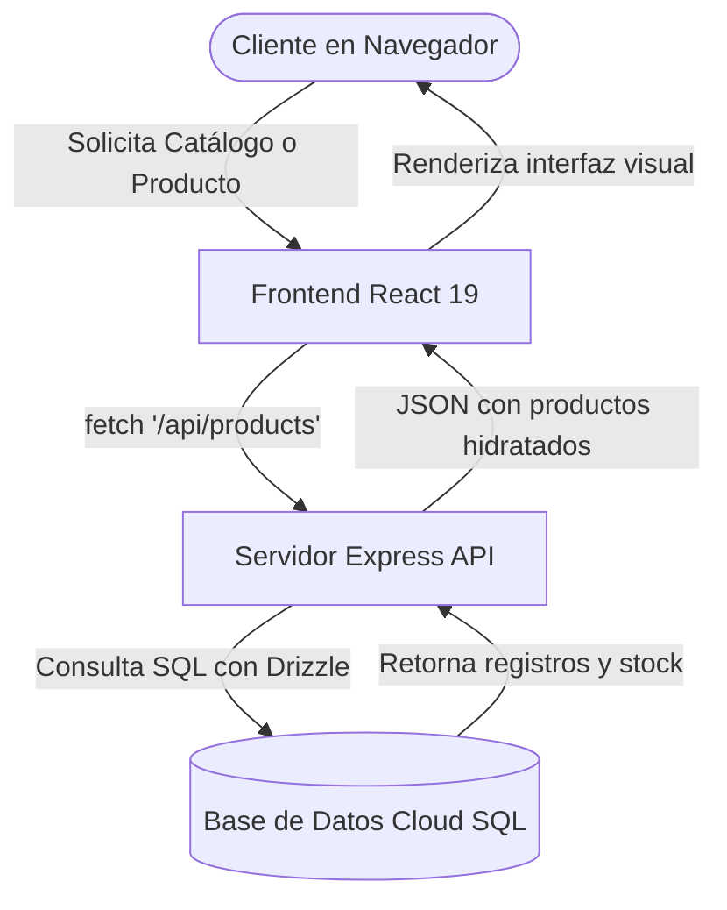
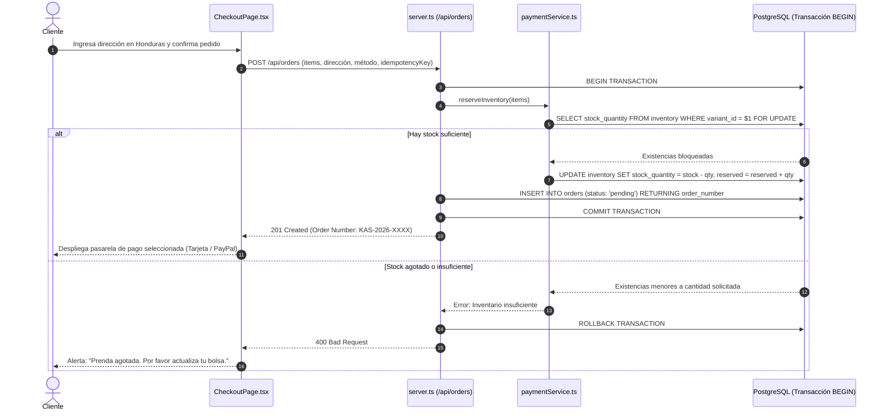
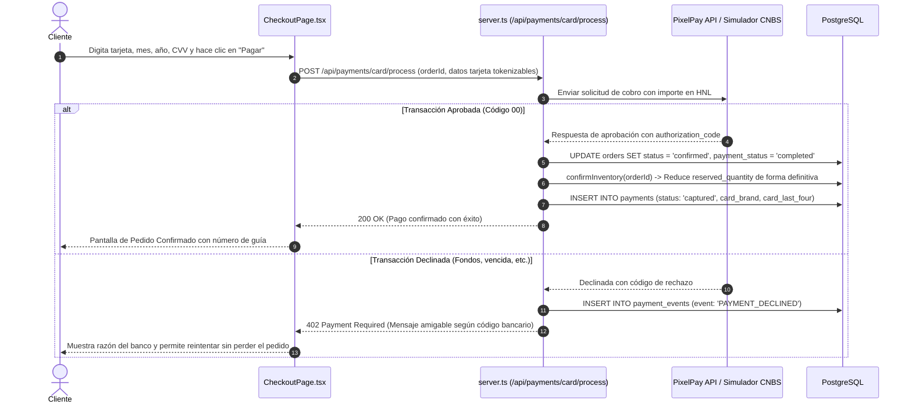

# GUÍA TÉCNICA, MAPA DE ARCHIVOS Y MANUAL DE MODIFICACIONES — KAS STORE

```
========================================================================================
Proyecto:              KAS Store — Tienda Especializada en Mezclilla y Jeans
Ubicación Comercial:   La Masica, Departamento de Atlántida, República de Honduras
Estudio de Diseño:     Mora-Grafic's Studio (https://mora-grafics-studio.com/)
Versión Documentada:   1.0.0 (Fase 6 — Auditoría y Manual de Arquitectura)
Fecha de Elaboración:  Octubre de 2026
Entorno de Ejecución:  Node.js 22+ / React 19 / TypeScript / Vite / Tailwind CSS v4 / Cloud SQL PostgreSQL
========================================================================================
```

---

## ÍNDICE GENERAL

1. [Objetivo y Alcance del Documento](#1-objetivo-y-alcance-del-documento)
2. [Auditoría Integral de la Estructura de Archivos](#2-auditoría-integral-de-la-estructura-de-archivos)
3. [Mapa de Archivos por Sección de la Tienda](#3-mapa-de-archivos-por-sección-de-la-tienda)
   - [A. Identidad Visual y Diseño de Marca](#a-identidad-visual-y-diseño-de-marca)
   - [B. Página de Inicio (Home)](#b-página-de-inicio-home)
   - [C. Catálogo y Gestión de Productos](#c-catálogo-y-gestión-de-productos)
   - [D. Página de Detalle de Producto](#d-página-de-detalle-de-producto)
   - [E. Bolsa de Compras y Carrito](#e-bolsa-de-compras-y-carrito)
   - [F. Checkout y Creación de Pedidos](#f-checkout-y-creación-de-pedidos)
   - [G. Integración de Pasarelas de Pago](#g-integración-de-pasarelas-de-pago)
   - [H. Panel Administrativo de la Tienda](#h-panel-administrativo-de-la-tienda)
   - [I. Sistema Logístico y Envíos en Honduras](#i-sistema-logístico-y-envíos-en-honduras)
   - [J. Canales de Contacto y WhatsApp](#j-canales-de-contacto-y-whatsapp)
   - [K. SEO, Metadatos y Páginas Legales](#k-seo-metadatos-y-páginas-legales)
   - [L. Notificaciones y Correos Electrónicos](#l-notificaciones-y-correos-electrónicos)
4. [Tabla Maestra de Modificaciones](#4-tabla-maestra-de-modificaciones)
5. [Mapas de Flujo de Datos (Diagramas Mermaid)](#5-mapas-de-flujo-de-datos)
6. [Inventario de Variables de Entorno](#6-inventario-de-variables-de-entorno)
7. [Base de Datos Relacional y Modelado de Datos](#7-base-de-datos-relacional-y-modelado-de-datos)
8. [Protocolo de Seguridad para Modificar el Código sin Romperlo](#8-protocolo-de-seguridad-para-modificar-el-código-sin-romperlo)
9. [Glosario y Guía Práctica para el Propietario](#9-glosario-y-guía-práctica-para-el-propietario)
10. [Estado de Verificación, Limitaciones Conocidas y Observaciones](#10-estado-de-verificación-limitaciones-conocidas-y-observaciones)

---

## 1. OBJETIVO Y ALCANCE DEL DOCUMENTO

Este manual ha sido elaborado específicamente para el propietario y los desarrolladores de **KAS Store**. Su propósito es servir como documento de consulta permanente para comprender la arquitectura real de la aplicación, localizar de forma inmediata qué archivo modificar ante cualquier cambio comercial y garantizar que el sistema opere con estabilidad, seguridad transaccional y cumplimiento legal en Honduras.

### Reglas Clave de Mantenimiento
- **Fuente de verdad híbrida y tolerante a fallos:** El catálogo se alimenta de la base de datos relacional PostgreSQL a través de `/api/products`. Si la base de datos no estuviera disponible, el sistema cuenta con un respaldo en memoria (`src/data/mockProducts.ts`) para garantizar que la tienda nunca muestre una pantalla en blanco a los clientes.
- **Seguridad en pagos y PCI-DSS:** El sistema nunca almacena números de tarjeta ni CVV. Solo guarda identificadores de transacción provistos por PixelPay o PayPal.
- **Inventario transaccional:** Toda orden bloquea las existencias en PostgreSQL con `SELECT FOR UPDATE` para impedir la sobreventa de jeans.

---

## 2. AUDITORÍA INTEGRAL DE LA ESTRUCTURA DE ARCHIVOS

### 2.1 Árbol Real del Proyecto

```
/
├── index.html                           # Punto de entrada HTML con SEO y Schema.org
├── server.ts                            # Servidor Node.js + Express (API REST y estáticos)
├── package.json                         # Definición de dependencias y scripts de ejecución
├── tsconfig.json                        # Configuración del compilador TypeScript
├── vite.config.ts                       # Configuración de compilación de Vite y Tailwind
├── metadata.json                        # Metadatos del entorno AI Studio
├── firebase-applet-config.json          # Configuración de proyecto Firebase
├── CHECKOUT_Y_PAGOS.md                  # Bitácora de pasarelas de pago y sandbox
├── DESPLIEGUE_Y_OPERACIONES.md          # Manual de infraestructura, Cloud Run y backups
│
├── public/                              # Archivos públicos servidos directamente
│   ├── robots.txt                       # Directivas para rastreadores de motores de búsqueda
│   ├── sitemap.xml                      # Mapa del sitio XML con rutas y productos
│   ├── uploads/                         # Directorio de imágenes subidas desde el panel admin
│   └── assets/
│       └── aistudio/
│           └── Logotipo_KAS_Store_9c74b5ef.png  # Logotipo oficial de KAS Store
│
├── src/                                 # Código fuente del Frontend y Lógica Compartida
│   ├── main.tsx                         # Punto de entrada de React 19 (montaje en #root)
│   ├── App.tsx                          # Enrutador principal de vistas y layout global
│   ├── index.css                        # Estilos globales y paleta @theme de Tailwind v4
│   ├── types.ts                         # Definición de tipos TypeScript e interfaces
│   │
│   ├── assets/                          # Activos de diseño
│   │   └── images/                      # Fotografías de modelos y tonalidades de mezclilla
│   │
│   ├── components/                      # Componentes reutilizables de UI
│   │   ├── Header.tsx                   # Barra de anuncio, navegación, búsqueda y bolsa
│   │   ├── Footer.tsx                   # Pie de página, enlaces de servicio y copyright
│   │   ├── ProductCard.tsx              # Tarjeta de producto en catálogo y destacados
│   │   ├── ProductImage.tsx             # Renderizador seguro de imágenes con fallback
│   │   ├── CartDrawer.tsx               # Drawer deslizable lateral de la bolsa de compras
│   │   ├── AccountModal.tsx             # Modal de cuenta cliente y panel de control admin
│   │   ├── SizeGuideModal.tsx           # Modal de guía de tallas (Hombre, Mujer, Niño, Niña)
│   │   └── WhatsAppButton.tsx           # Botón flotante interactivo de atención por WhatsApp
│   │
│   ├── context/                         # Proveedores de estado global (React Context)
│   │   ├── AuthContext.tsx              # Autenticación con Firebase y sincronización de roles
│   │   ├── CartContext.tsx              # Estado de la bolsa, cantidades y totales en HNL
│   │   └── WishlistContext.tsx          # Gestión de favoritos sincronizada con backend
│   │
│   ├── data/                            # Datos estáticos y diccionarios
│   │   ├── mockProducts.ts              # Catálogo base de jeans, imágenes hero y categorías
│   │   └── hondurasLocations.ts         # Lista de 18 departamentos y municipios de Honduras
│   │
│   ├── db/                              # Base de datos relacional PostgreSQL con Drizzle ORM
│   │   ├── index.ts                     # Conexión al pool pg (soporta Cloud SQL y local)
│   │   ├── schema.ts                    # Esquema relacional de tablas, tipos y relaciones
│   │   ├── seed.ts                      # Script de inicialización con productos y cupones
│   │   ├── users.ts                     # Funciones de consulta y creación de usuarios
│   │   └── drizzle.config.ts            # Configuración para migraciones de Drizzle Kit
│   │
│   ├── lib/                             # Bibliotecas auxiliares y utilidades
│   │   ├── cardValidation.ts            # Validación Luhn y detección de marcas de tarjetas
│   │   ├── shippingRates.ts             # Tarifario y cálculo oficial por zonas de Honduras
│   │   ├── firebase.ts                  # Inicialización del SDK cliente de Firebase
│   │   ├── firebase-config.ts           # Variables de configuración de Firebase cliente
│   │   └── firebase-admin.ts            # Inicialización de Firebase Admin para backend
│   │
│   ├── middleware/                      # Interceptores de peticiones Express
│   │   └── auth.ts                      # requireAuth, requireAdmin y optionalAuth
│   │
│   ├── pages/                           # Páginas o vistas principales de la aplicación
│   │   ├── HomePage.tsx                 # Portada editorial, banner hero, destacados y FAQs
│   │   ├── CatalogPage.tsx              # Catálogo con filtros de mezclilla, búsqueda y tallas
│   │   ├── ProductDetailPage.tsx        # Detalle del jean, selector de variantes y compra
│   │   ├── CartPage.tsx                 # Vista completa de la bolsa con desglose de costos
│   │   ├── CheckoutPage.tsx             # Proceso de pago, dirección en Honduras y pasarelas
│   │   ├── FavoritesPage.tsx            # Lista de jeans guardados por el usuario
│   │   ├── PoliciesPage.tsx             # Centro de políticas legales, envíos y devoluciones
│   │   └── NotFoundPage.tsx             # Página de error 404 personalizada
│   │
│   └── services/                        # Capa de comunicación y lógica de negocio
│       ├── api.ts                       # Cliente HTTP frontend para interactuar con la API
│       ├── cartStorage.ts               # Persistencia de carrito y favoritos en localStorage
│       └── paymentService.ts            # Lógica transaccional de pagos, PixelPay y PayPal
```

---

## 3. MAPA DE ARCHIVOS POR SECCIÓN DE LA TIENDA

### A. Identidad Visual y Diseño de Marca

| Elemento de Diseño | Archivo Responsable | Dónde y Cómo Modificarlo |
|---|---|---|
| **Logotipo oficial** | `/public/assets/aistudio/Logotipo_KAS_Store_9c74b5ef.png` | Reemplazar el archivo PNG manteniendo el nombre o cambiar la ruta en `Header.tsx` (L. 84), `Footer.tsx` (L. 59), `HomePage.tsx` (L. 79) e `index.html` (L. 12). |
| **Paleta de Colores (Arena y Terracota)** | `/src/index.css` | En el bloque `@theme` (L. 3-13). Modifica variables: `--color-arena: #E8DEC9;`, `--color-crema: #FAF7F2;`, `--color-beige: #D9CCB8;`, `--color-arena-tropical: #B88B4A;`, `--color-arena-oscura: #8A622A;`, `--color-arena-tostada: #2E2721;`, `--color-blanco-calido: #FFFEFC;`. |
| **Tipografías** | `/index.html` e `/src/index.css` | Google Fonts en `index.html` (L. 16): `Playfair Display` (serif) y `Plus Jakarta Sans` (sans). En `index.css`: `--font-serif` y `--font-sans`. |
| **Estilos de Botones y Sombras** | Clases utilitarias de Tailwind en componentes | Los botones principales usan `bg-[#B88B4A] hover:bg-[#8A622A] text-[#FFFEFC]` con esquinas rectas (`rounded-none` o `rounded-sm`). |
| **Iconografía** | Todo el proyecto | Utiliza la librería `lucide-react`. Para cambiar un icono, importa el nuevo nombre desde `lucide-react` en el componente respectivo. |

### B. Página de Inicio (Home)

**Archivo principal:** `/src/pages/HomePage.tsx`

- **Banner Principal / Hero:** Líneas 72 a 155. Contiene el logotipo en tamaño destacado, el título *"Tu estilo, tu esencia"*, la descripción del negocio y los botones *"Comprar colección"* y *"Descubrir novedades"*.
- **Imagen del Hero:** Constante `HERO_IMAGE` importada desde `/src/data/mockProducts.ts` (L. 3). Para cambiar la foto de portada, actualiza la ruta del archivo JPG en `mockProducts.ts`.
- **Productos Destacados y Novedades:** Líneas 39-40. Se filtran automáticamente con `productsList.filter(p => p.isFeatured)` y `productsList.filter(p => p.isNew)`.
- **Beneficios de Compra:** Líneas 406 a 460. Contiene los 4 pilares: *Envíos a Todo Honduras*, *Mezclilla Auténtica*, *Asesoría WhatsApp* y *Cambios Sencillos*.
- **Preguntas Frecuentes (FAQ):** Líneas 46 a 67. Arreglo `faqs` con preguntas y respuestas editables directamente en el código.

### C. Catálogo y Gestión de Productos

**Archivos involucrados:**
- Frontend: `/src/pages/CatalogPage.tsx`
- Backend API: `/server.ts` (Endpoint `GET /api/products`, L. 78-202)
- Modelo de Datos: `/src/db/schema.ts` (`products`, `product_variants`, `inventory`, `product_images`)
- Respaldo en memoria: `/src/data/mockProducts.ts`

**¿Cómo funciona la fuente de verdad?**
1. Al cargar el catálogo, `CatalogPage.tsx` ejecuta `api.getProducts()`.
2. El servidor consulta la tabla `products` en PostgreSQL, uniendo las imágenes (`product_images`) y las variantes con su stock real (`inventory`).
3. Si la base de datos responde correctamente, el estado `isDbSynced` pasa a `true` y muestra los productos de PostgreSQL.
4. Si la base de datos estuviera desconectada, la función atrapa el error y utiliza `MOCK_PRODUCTS` de forma transparente.

### D. Página de Detalle de Producto

**Archivo de Presentación:** `/src/pages/ProductDetailPage.tsx`  
**Endpoint de Lógica:** `/server.ts` (`GET /api/products/:slugOrId`, L. 205-303)

- **Galería de Imágenes:** Líneas 55-60 y componente `ProductImage.tsx`. Permite cambiar la foto activa mediante miniaturas.
- **Selector de Tallas y Colores:** Líneas 160-230. Valida si la combinación específica tiene unidades en stock llamando a `isVariantOutOfStock()`. Si está agotada, el botón muestra *"Agotado en esta combinación"*.
- **Acciones:**
  - *Agregar a la Bolsa:* Ejecuta `addItem(product, selectedSize, selectedColor, quantity)` de `CartContext.tsx` y despliega el `CartDrawer`.
  - *Comprar Ahora:* Agrega el jean a la bolsa y redirige automáticamente a la vista de `checkout`.

### E. Bolsa de Compras y Carrito

**Archivos involucrados:**
- Estado Global: `/src/context/CartContext.tsx`
- Persistencia Local: `/src/services/cartStorage.ts`
- Vista Drawer Deslizable: `/src/components/CartDrawer.tsx`
- Página Completa de Bolsa: `/src/pages/CartPage.tsx`
- Validación en Servidor: `/server.ts` (`POST /api/checkout/calculate`, L. 366-460)

**Regla de Seguridad:** El cálculo visual del carrito en el cliente (`subtotalHnl` y `shippingHnl` en `CartContext.tsx`) es solo informativo. Cuando el usuario procede a pagar, el servidor en `/api/checkout/calculate` y en `/api/orders` recalcula de manera obligatoria los precios consultando los valores oficiales en la base de datos para impedir manipulaciones en el navegador.

### F. Checkout y Creación de Pedidos

**Archivo Frontend:** `/src/pages/CheckoutPage.tsx`  
**Endpoints Backend:** `/server.ts`
- `POST /api/checkout/calculate` (L. 366): Cálculo autoritativo de subtotal, descuento de cupón y tarifa de envío.
- `POST /api/orders` (L. 463-734): Creación transaccional del pedido con reserva de inventario.
- `GET /api/orders/:orderNumber` (L. 937): Consulta de pedido por número único.

**Flujo de Reserva de Inventario:**
1. El backend abre una transacción PostgreSQL con `client.query('BEGIN')`.
2. Ejecuta `reserveInventory()` en `/src/services/paymentService.ts`, aplicando `SELECT stock_quantity, reserved_quantity FROM inventory WHERE variant_id = $1 FOR UPDATE`.
3. Si hay suficiente stock, incrementa `reserved_quantity` y decrementa `stock_quantity`.
4. Si alguna prenda no tiene existencias, la transacción hace `ROLLBACK` y el cliente recibe un error HTTP 400 sin crear pedidos huérfanos.

### G. Integración de Pasarelas de Pago

#### G.1 PixelPay Honduras (Tarjetas de Crédito y Débito)
- **Archivos:** `/src/services/paymentService.ts` (L. 165-275), `/src/lib/cardValidation.ts`, `/server.ts` (L. 739-781).
- **Moneda de liquidación:** Lempiras (HNL).
- **Modo Sandbox / Pruebas:** Si no se detectan las variables `PIXELPAY_KEY` y `PIXELPAY_SECRET`, el sistema activa el simulador bancario interno que responde con los códigos reglamentarios de la CNBS:
  - Tarjeta `4242 4242 4242 4242` → **Aprobada** (`00`).
  - Tarjeta `4000 0000 0000 0002` → **Declinada: Fondos Insuficientes** (`51`).
  - Tarjeta `4000 0000 0000 0004` → **Declinada: Tarjeta Vencida** (`54`).
  - Tarjeta `4000 0000 0000 0005` → **Declinada: Fallo de Autenticación 3D-Secure** (`3DS_FAILED`).
  - Tarjeta `4000 0000 0000 9999` → **Fallo de Red / Timeout Bancario** (`96`).
- **Webhook:** `/api/webhooks/pixelpay` (L. 856 en `server.ts`).

#### G.2 PayPal REST API v2 (Pagos Internacionales)
- **Archivos:** `/src/services/paymentService.ts` (L. 280-380), `/server.ts` (L. 786-818).
- **Moneda:** Dólares Estadounidenses (USD). Utiliza la tasa oficial de conversión configurada en `HNL_TO_USD_RATE = 25.50`.
- **Endpoints:**
  - `POST /api/payments/paypal/create-order`
  - `POST /api/payments/paypal/capture-order`
- **Webhook:** `/api/webhooks/paypal` (L. 883 en `server.ts`).

### H. Panel Administrativo de la Tienda

**Archivo Frontend:** `/src/components/AccountModal.tsx`  
**Endpoints Backend:** `/server.ts` (Protegidos con `requireAuth` y `requireAdmin`)
- `GET /api/admin/orders` (L. 1015): Lista los últimos 50 pedidos con sus artículos y estado de envío.
- `PATCH /api/admin/orders/:id/status` (L. 1047): Permite al administrador cambiar el estado a: `confirmed`, `processing`, `shipped`, `delivered` o `cancelled`.
- `GET /api/admin/inventory` (L. 1096): Lista todas las variantes de pantalones registradas en la base de datos con su SKU y stock actual.
- `PATCH /api/inventory/:variantId` (L. 1126): Actualiza el número de unidades en stock de una variante específica.
- `POST /api/admin/images/upload` (L. 1145): Recibe imágenes en base64 (JPEG, PNG, WEBP de hasta 5MB), las valida y las guarda en `/public/uploads/`, retornando la URL pública para asociarla al producto.

### I. Sistema Logístico y Envíos en Honduras

**Archivos:** `/src/lib/shippingRates.ts` y `/src/data/hondurasLocations.ts`

- **Departamentos y Municipios:** `HONDURAS_DEPARTMENTS` contiene los 18 departamentos y los principales municipios, incluyendo *"La Masica (Sede KAS Store)"* como primera opción en Atlántida.
- **Tarifario por Zonas Geográficas:**
  1. *Zona Atlántida (Local):* L 80.00 (Entrega en 24 hrs por mensajería local).
  2. *Zona Norte (Cortés, Yoro):* L 110.00 (24 a 48 hrs por Cargo Expreso / Mirna).
  3. *Zona Centro-Sur (Francisco Morazán, Comayagua, La Paz, Choluteca, Valle):* L 130.00 (48 hrs).
  4. *Zona Foránea (Colón, Copán, Olancho, Islas de la Bahía, etc.):* L 150.00 (48 a 72 hrs).
- **Umbral de Envío Gratuito:** Definido en la constante `FREE_SHIPPING_THRESHOLD_HNL = 1500`. En compras de L 1,500.00 o más, el costo de envío es L 0.00 automáticamente.

### J. Canales de Contacto y WhatsApp

- **Botón Flotante:** `/src/components/WhatsAppButton.tsx` (L. 38). Número configurado: `+504 3305-6175`. Mensaje predefinido codificado en URL: `Hola KAS Store, quisiera información sobre los pantalones de mezclilla`.
- **Cabecera y Barra Superior:** `/src/components/Header.tsx` (L. 52-58).
- **Pie de Página:** `/src/components/Footer.tsx` (L. 73-81 y L. 208-242).
- **Centro de Contacto:** `/src/pages/PoliciesPage.tsx` (Pestaña `contacto`).
- **Datos de la Sede:** Barrio El Centro, La Masica, Atlántida, Honduras. Correo: `k-andradesantos@gmail.com`.

### K. SEO, Metadatos y Páginas Legales

- **Metaetiquetas y Schema.org:** `/index.html`. Contiene el objeto JSON-LD `@type: "ClothingStore"` con dirección postal en La Masica, teléfono, coordenadas geográficas y catálogo indexable.
- **Directivas para Motores de Búsqueda:** `/public/robots.txt`.
- **Mapa de URLs:** `/public/sitemap.xml`.
- **Centro de Políticas:** `/src/pages/PoliciesPage.tsx` con navegación por pestañas:
  - `envios`: Políticas de despacho y transportistas en Honduras.
  - `devoluciones`: 10 días para cambio de talla sin uso.
  - `terminos`: Términos de compra conforme a la Ley de Comercio Electrónico (Decreto 149-2014).
  - `privacidad`: Manejo ético de datos del comprador.
  - `contacto`: Canales oficiales de soporte.
  - `faq`: Preguntas frecuentes de clientes.
- **Página de Error 404:** `/src/pages/NotFoundPage.tsx`.

### L. Notificaciones y Correos Electrónicos

- **Estado Actual:** El backend actual registra todos los eventos de confirmación en la tabla `payment_events`. Las variables para proveedor de correo transaccional (`RESEND_API_KEY`, `EMAIL_FROM`, `ADMIN_ALERT_EMAIL`) están contempladas en `.env.example` y documentadas en `DESPLIEGUE_Y_OPERACIONES.md`.
- **Notificación por WhatsApp:** En la arquitectura actual, la notificación y coordinación de guías de entrega se realiza de forma directa e inmediata a través de la API oficial de enlace de WhatsApp (`https://wa.me/50433056175`).

---

## 4. TABLA MAESTRA DE MODIFICACIONES

Esta tabla es la guía de referencia rápida para que el propietario o desarrollador sepa con exactitud qué archivo tocar según la necesidad del negocio:

| # | Cambio que deseo realizar | Archivos a revisar | Función del archivo | Tipo de modificación | Nivel de Riesgo | ¿Cómo probar el cambio? |
|---|---|---|---|---|---|---|
| 1 | **Cambiar el Logotipo** | `/public/assets/aistudio/Logotipo_KAS_Store_9c74b5ef.png` | Archivo gráfico del logo | Reemplazo de archivo multimedia | Bajo | Abrir el navegador con recarga forzada (`Ctrl + F5`) en Inicio y Header. |
| 2 | **Cambiar colores de la marca** | `/src/index.css` | Define tokens `@theme` de Tailwind | Modificación de variables CSS | Medio (afecta botones y fondos) | Navegar por la tienda y verificar que los contrastes de texto sigan legibles. |
| 3 | **Modificar textos del banner principal** | `/src/pages/HomePage.tsx` | Renderiza la portada | Edición de texto JSX (L. 100-107) | Bajo | Recargar la página principal y comprobar la tipografía en móvil y PC. |
| 4 | **Cambiar los productos destacados** | Panel Admin o `/src/data/mockProducts.ts` y tabla `products` | Marcador booleano `isFeatured` | Base de datos o código | Bajo | Abrir la página de inicio y verificar que aparezcan en la sección *"Destacados"*. |
| 5 | **Añadir un nuevo pantalón** | `/src/data/mockProducts.ts` y tabla `products` de PostgreSQL | Catálogo de productos | Inserción en base de datos o arreglo | Medio | Entrar a `/api/products` y verificar que el nuevo slug cargue en el catálogo. |
| 6 | **Cambiar precio de un jean** | Base de datos (`products.basePriceHnl`) o `/src/data/mockProducts.ts` | Almacena precio oficial en HNL | Edición de número decimal | Medio | Abrir el detalle del producto, agregar al carrito y comprobar el subtotal. |
| 7 | **Modificar las tallas disponibles** | `/src/data/mockProducts.ts` y tabla `product_variants` | Variantes del producto | Edición de arreglo `availableSizes` | Medio | Ir al detalle del jean y comprobar que el selector muestre las tallas correctas. |
| 8 | **Subir nuevas fotografías de jeans** | Panel Admin (`AccountModal.tsx` > Subir Imagen) | Guarda archivo en `/public/uploads/` | Uso de interfaz administrativa | Bajo | Subir foto desde el panel, copiar la URL generada y asignarla al producto. |
| 9 | **Cambiar el número de WhatsApp** | `/src/components/WhatsAppButton.tsx`, `Header.tsx`, `Footer.tsx` | Enlaces `wa.me/504...` | Reemplazo de cadena de texto | Bajo | Hacer clic en el botón flotante de WhatsApp y verificar que abra el chat correcto. |
| 10 | **Modificar tarifas de envío por departamento** | `/src/lib/shippingRates.ts` | Objeto `HONDURAS_SHIPPING_ZONES` | Edición de valores numéricos en HNL | Medio (afecta total de pedidos) | En checkout, seleccionar el departamento modificado y validar la tarifa en el resumen. |
| 11 | **Cambiar el umbral de envío gratis** | `/src/lib/shippingRates.ts` | Constante `FREE_SHIPPING_THRESHOLD_HNL` | Edición de constante numérica | Medio | En carrito, agregar prendas hasta superar el monto y verificar que el flete marque L 0.00. |
| 12 | **Modificar campos del formulario de compra** | `/src/pages/CheckoutPage.tsx` y `/server.ts` | Interfaz y validación de checkout | Código React y validación Express | Alto (puede bloquear pedidos) | Realizar una compra de prueba en sandbox de inicio a fin comprobando la BD. |
| 13 | **Ajustar existencias de inventario** | Panel Admin (`AccountModal.tsx` > Inventario) | Modifica tabla `inventory` | Edición desde interfaz administrativa | Bajo | Entrar con usuario administrador, cambiar el número de stock y dar clic en *"Guardar"*. |
| 14 | **Habilitar credenciales reales de PixelPay** | Archivo `.env` en el servidor | `PIXELPAY_KEY`, `PIXELPAY_SECRET` | Configuración de servidor | Alto (inicia cobros reales) | Verificar primero con tarjeta corporativa del negocio y confirmar depósito bancario. |
| 15 | **Habilitar credenciales reales de PayPal** | Archivo `.env` en el servidor | `PAYPAL_CLIENT_ID`, `PAYPAL_CLIENT_SECRET` | Configuración de servidor | Alto | Probar una compra internacional en vivo por un monto controlado. |
| 16 | **Modificar políticas legales o términos** | `/src/pages/PoliciesPage.tsx` | Contenido legal y cláusulas | Edición de texto JSX | Bajo | Navegar a `/politicas`, revisar la pestaña correspondiente y validar formato. |
| 17 | **Crear o modificar un cupón de descuento** | Tabla `coupons` en PostgreSQL o `/src/db/seed.ts` | Códigos y porcentaje de descuento | Registro en base de datos | Bajo | En la pantalla de checkout, escribir el cupón en el campo de texto y dar *"Aplicar"*. |

---

## 5. MAPAS DE FLUJO DE DATOS

### 5.1 Flujo General: Navegador → Frontend → API → Base de Datos



### 5.2 Flujo de Checkout con Reserva Transaccional de Inventario



### 5.3 Flujo de Pago con Tarjeta (PixelPay Honduras)



---

## 6. INVENTARIO DE VARIABLES DE ENTORNO

A continuación se detalla la matriz de variables de entorno del sistema. **Por razones de seguridad, nunca se deben colocar valores reales en archivos bajo control de versiones:**

| Variable | Servicio | Propósito | ¿Pública o Secreta? | Dónde se configura | ¿Obligatoria en Prod? | Cómo verificarla en ejecución |
|---|---|---|---|---|---|---|
| `PORT` | Servidor Express | Puerto de escucha HTTP | Pública (Sistema) | `.env` / Cloud Run | Sí (Por defecto 3000) | Ver log al iniciar: `Server running on port 3000` |
| `NODE_ENV` | Entorno | `development` o `production` | Pública | `.env` / Dockerfile | Sí | Define si se levanta Vite dev o dist estático |
| `DATABASE_URL` | PostgreSQL | Cadena de conexión para Drizzle Kit | **Secreta** | `.env` | Sí | `npx drizzle-kit studio` conecta sin error |
| `PGHOST` | Driver pg | Servidor de base de datos | Secreta | `.env` | Sí | `GET /api/health` retorna `status: ok` |
| `PGPORT` | Driver pg | Puerto de PostgreSQL (5432) | Pública | `.env` | Sí | Verificada junto a PGHOST |
| `PGUSER` | Driver pg | Usuario de base de datos | Secreta | `.env` | Sí | Verificada en conexión de arranque |
| `PGPASSWORD` | Driver pg | Contraseña de base de datos | **Secreta** | `.env` | Sí | Verificada en conexión de arranque |
| `PGDATABASE` | Driver pg | Nombre de base de datos | Pública | `.env` | Sí | Verificada en conexión de arranque |
| `PGSSLMODE` | Driver pg | Modo SSL (`require` en nube) | Pública | `.env` | Sí en nube | Evita rechazo por falta de cifrado en nube |
| `PIXELPAY_KEY` | PixelPay | Llave pública de comercio | Pública de integración | `.env` | Opcional (Modo Sandbox si falta) | `GET /api/payments/test-suite` muestra `isLiveConfigured` |
| `PIXELPAY_SECRET` | PixelPay | Llave secreta para firmar cobros | **Altamente Secreta** | `.env` | Opcional (Modo Sandbox si falta) | Comprobada internamente en `paymentService.ts` |
| `PIXELPAY_AUTH_TOKEN` | PixelPay | Token Bearer para API v2 | **Secreta** | `.env` | Opcional | Comprobada en peticiones HTTP salientes |
| `PAYPAL_API_BASE` | PayPal | URL base (sandbox o live) | Pública | `.env` | Sí (`https://api-m.paypal.com`) | Verificada al crear orden |
| `PAYPAL_CLIENT_ID` | PayPal | Identificador de aplicación | Pública de integración | `.env` | Opcional (Sandbox si falta) | `GET /api/payments/test-suite` muestra `isLiveConfigured` |
| `PAYPAL_CLIENT_SECRET`| PayPal | Clave secreta OAuth de PayPal | **Altamente Secreta** | `.env` | Opcional (Sandbox si falta) | Comprobada en obtención de token OAuth |
| `FIREBASE_PROJECT_ID`| Firebase | Proyecto de autenticación | Pública | `firebase-applet-config.json` | Sí | Login con Google funciona |

---

## 7. BASE DE DATOS RELACIONAL Y MODELADO DE DATOS

El proyecto utiliza **PostgreSQL** administrado mediante **Drizzle ORM** (definido en `/src/db/schema.ts`).

### 7.1 Tablas y Entidades del Sistema

1. **`users`:** Almacena el perfil del cliente sincronizado con Firebase Auth (`uid`, `email`, `full_name`, `phone`, `role`: `'admin'` o `'customer'`).
2. **`categories`:** Categorías de mezclilla (`slug`, `name`, `gender_target`, `image_url`, `display_order`).
3. **`products`:** Registro maestro de jeans (`slug`, `name`, `base_price_hnl`, `gender`, `fit_type`, `denim_wash`, `fabric_composition`, `is_published`, `is_featured`, `is_new`, `is_sale`).
4. **`product_images`:** Galería de imágenes de cada prenda con orden de visualización (`product_id`, `image_url`, `alt_text`, `is_primary`).
5. **`product_variants`:** Variantes por combinación de talla y color (`product_id`, `size`, `color_name`, `color_hex`, `sku`, `price_adjustment_hnl`).
6. **`inventory`:** Existencias en tiempo real (`variant_id`, `stock_quantity`, `reserved_quantity`, `low_stock_threshold`).
7. **`coupons`:** Cupones de descuento promocionales (`code`, `discount_percent`, `discount_amount_hnl`, `min_purchase_hnl`, `max_uses`, `used_count`).
8. **`orders`:** Pedidos realizados (`order_number`, `user_id`, `guest_email`, `status`, `subtotal_hnl`, `discount_hnl`, `shipping_fee_hnl`, `total_hnl`, `shipping_departamento`, `shipping_municipio`, `shipping_address`, `idempotency_key`).
9. **`order_items`:** Snapshot histórico de cada artículo comprado (`order_id`, `product_id`, `product_name_snapshot`, `size_snapshot`, `color_snapshot`, `unit_price_hnl_snapshot`, `quantity`, `line_total_hnl`).
10. **`payments`:** Transacciones financieras (`order_id`, `amount_hnl`, `currency`, `provider`, `status`, `transaction_reference`, `card_brand`, `card_last_four`).
11. **`payment_events`:** Registro de auditoría y webhooks recibidos (`order_id`, `provider`, `event_type`, `payload`).
12. **`shipments`:** Información de despacho (`order_id`, `tracking_number`, `carrier_name`, `status`, `estimated_delivery_at`).
13. **`wishlist_items`:** Artículos favoritos guardados por clientes registrados (`user_id`, `product_id`).

### 7.2 Cómo añadir un nuevo campo en la base de datos
Si en el futuro se necesita añadir un campo (por ejemplo, `instagram_url` en la tabla de tiendas o `delivery_instructions` en pedidos):
1. Abrir `/src/db/schema.ts` y añadir la columna en la definición de la tabla con su tipo de dato.
2. Ejecutar en terminal: `npx drizzle-kit push` para aplicar la modificación a PostgreSQL de forma segura.
3. Actualizar la interfaz TypeScript correspondiente en `/src/types.ts`.

---

## 8. PROTOCOLO DE SEGURIDAD PARA MODIFICAR EL CÓDIGO SIN ROMPERLO

Para realizar cualquier modificación técnica sin afectar las ventas ni la estabilidad de la tienda, siga rigurosamente este protocolo de 10 pasos:

```
[1. Localizar Archivo]  --> [2. Revisar Dependencias] --> [3. Crear Copia/Rama]
         |
[4. Cambio Mínimo]      --> [5. Compilar (npm run build)] --> [6. Validar Linter (npm run lint)]
         |
[7. Probar Caso Feliz]  --> [8. Probar Errores/Bordes]  --> [9. Revisar Logs de Consola]
         |
[10. Aprobación y Despliegue a Producción]
```

### Reglas Críticas
1. **Nunca modifique archivos de pago sin validar en Sandbox:** Toda prueba de tarjetas debe realizarse primero con las tarjetas de prueba del test suite en `/api/payments/test-suite`.
2. **Respeto a las transacciones de inventario:** Cualquier cambio en `/api/orders` debe mantener el bloque `BEGIN ... COMMIT / ROLLBACK` y el `client.release()` en el bloque `finally` para no agotar el pool de conexiones de PostgreSQL.
3. **Validación de tipos:** Ejecutar `npm run lint` (`tsc --noEmit`) antes de cualquier despliegue. Si el compilador detecta un error de tipos, resuélvalo antes de compilar para producción.

---

## 9. GLOSARIO Y GUÍA PRÁCTICA PARA EL PROPIETARIO

Para facilitar la comunicación entre el propietario de la tienda y su equipo técnico, a continuación se definen los términos fundamentales en lenguaje accesible:

- **Frontend:** La parte visual de la tienda que el cliente ve en su celular o computadora (botones, fotos, textos y carrito).
- **Backend (API):** El servidor que opera tras bambalinas. Es el encargado de calcular los precios reales, descontar el inventario y hablar con los bancos.
- **Base de Datos (PostgreSQL):** El archivo digital permanente donde se guardan de forma organizada los pedidos, los clientes y la lista de pantalones.
- **Transacción de Base de Datos:** Una regla que asegura que todas las operaciones de una compra se completen con éxito o no se aplique ninguna. Evita que a un cliente se le cobre si el sistema se desconecta antes de guardar el pedido.
- **Idempotencia (`idempotency_key`):** Una protección que evita que un cliente sea cobrado dos veces si presiona repetidamente el botón de pago por impaciencia o conexión lenta.
- **Webhook:** Una notificación automática que la pasarela de pago (PixelPay o PayPal) envía a nuestro servidor para avisarle que un cobro fue autorizado.
- **Tokenización:** El método por el cual los datos de una tarjeta se convierten en un código seguro, permitiendo cobrar sin que nadie en KAS Store pueda ver el número de la tarjeta.

---

## 10. ESTADO DE VERIFICACIÓN, LIMITACIONES CONOCIDAS Y OBSERVACIONES

### 10.1 Módulos Verificados y Funcionales
- [x] Navegación completa en móvil, tableta y escritorio.
- [x] Catálogo con filtros reactivos y sincronización de base de datos.
- [x] Detalle de producto con bloqueo de combinaciones agotadas.
- [x] Bolsa de compras y drawer interactivo con persistencia local.
- [x] Checkout adaptado con los 18 departamentos y tarifas de flete de Honduras.
- [x] Reserva transaccional con `SELECT FOR UPDATE` en PostgreSQL.
- [x] Simulador bancario de pruebas con tarjetas de aprobación y códigos de rechazo CNBS.
- [x] Integración de órdenes de PayPal REST API v2.
- [x] Panel administrativo con actualización de estados de pedidos, edición de inventario en vivo y subida de fotos.
- [x] Marcado Schema.org, `robots.txt`, `sitemap.xml` y página 404 personalizada.

### 10.2 Limitaciones Conocidas y Pasos Pendientes para el Propietario
- **Credenciales Reales en Producción:** Las pasarelas operan actualmente en modo de prueba seguro (sandbox). Para procesar cobros bancarios reales, el propietario de KAS Store debe firmar el contrato comercial con PixelPay Honduras y configurar las llaves en las variables de entorno.
- **Revisión Legal Hondureña:** Los textos de las políticas fueron redactados tomando como modelo el Decreto 149-2014 (Ley de Comercio Electrónico) y el Decreto 24-2008 (Protección al Consumidor). Se recomienda su validación final por un profesional del derecho en Honduras.
- **Notificaciones por Correo:** El sistema registra los eventos de compra en la base de datos y provee enlaces a WhatsApp; la emisión de correos automáticos requerirá configurar las credenciales SMTP o API de Resend en el servidor.

---

*Manual técnico elaborado por Mora-Grafic's Studio para KAS Store. La Masica, Atlántida, Honduras. Todos los derechos reservados.*
